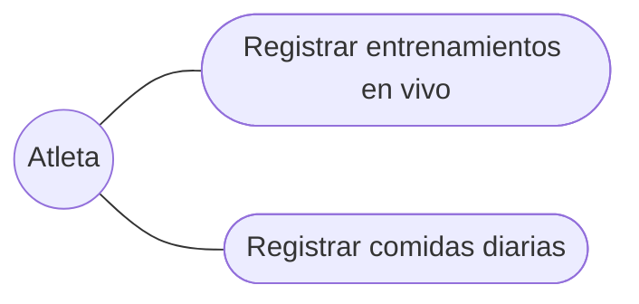
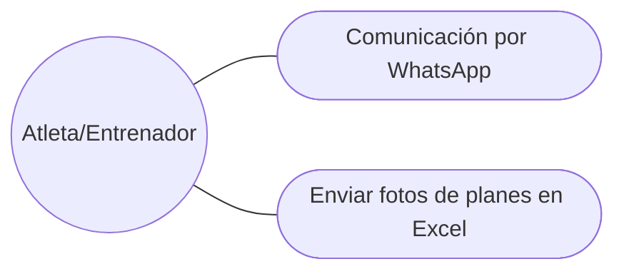
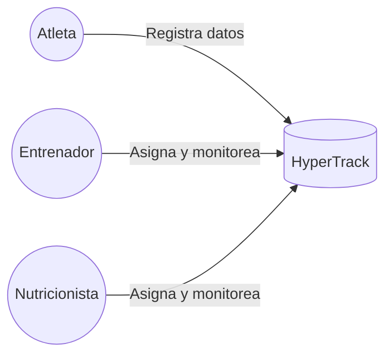
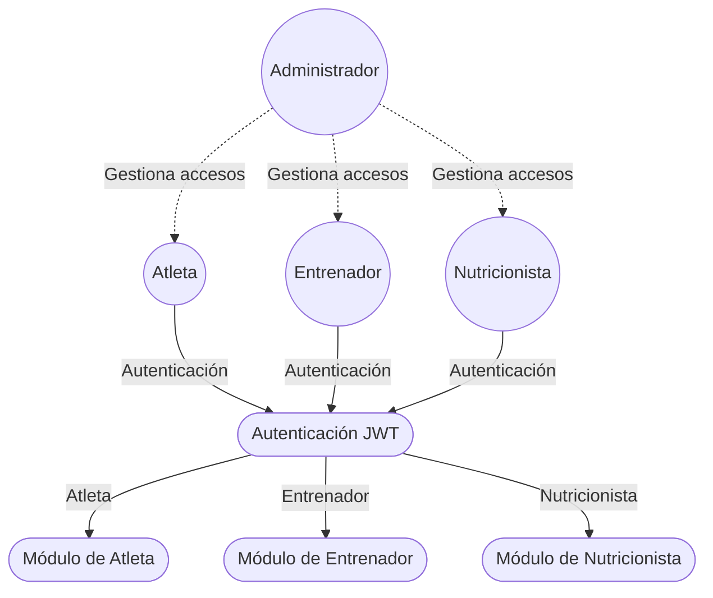
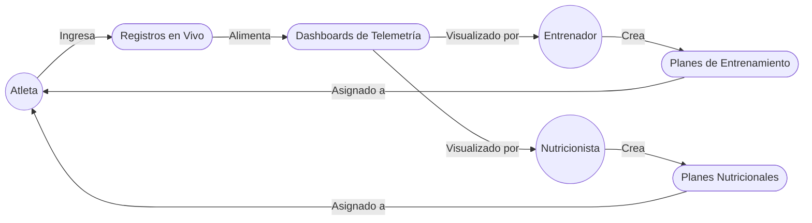

# Casos de Uso del Sistema HyperTrack

## 1. Casos de Uso Principales

A continuación se detallan los casos de uso del sistema y los actores involucrados, basados en la definición del proyecto:

| Casos de uso | Actores | Descripción |
| :--- | :--- | :--- |
| **Autenticar usuario** | Administrador | Gestiona el acceso al sistema mediante registro, login, logout, gestión de sesiones JWT y el sistema RBAC con los diferentes roles. |
| **Vincular profesional** | Atleta | Permite al atleta conectar su perfil con el de su entrenador y nutricionista privado mediante un sistema de vinculación bidireccional, asegurando la privacidad de los datos. |
| **Asignar plan de entrenamiento** | Entrenador | Permite crear, asignar rutinas y monitorear el progreso del atleta (volumen de carga, 1RM estimado). |
| **Asignar plan nutricional** | Nutricionista | Asignación de protocolos con calorías diarias y distribución de macronutrientes personalizados. |
| **Registrar entrenamientos en vivo** | Atleta | El atleta registra sesiones en vivo con ejercicios, series, repeticiones, peso y RPE. |
| **Registrar comidas diarias** | Atleta | Registro (logs) de comidas detallando macros y calorías (Desayuno, Almuerzo, Cena, Snack). |
| **Generar dashboards (Telemetría)** | Sistema | Visualización de métricas y gráficos interactivos para el monitoreo de los atletas por parte de los profesionales. |

---

## 2. Figuras y Diagramas de Casos de Uso

### Figura 1: Actores para la empresa HyperTrack
* **Descripción:** Muestra las interacciones de los actores principales con la plataforma.
    * **Atleta:** Interactúa registrando sus entrenamientos y comidas diarias.
    * **Entrenador y Nutricionista:** Se encargan de asignar planes especializados, evaluar el proceso calórico y monitorear el rendimiento.
    * **Administrador:** Gestiona los roles y accesos globales dentro del sistema.

### Figura 2: Cliente - Deportista federado
* **Descripción:** Diagrama que muestra cómo el atleta federado interactúa directamente con el sistema.

### Figura 3: Escenario "Sin sistema actual"
* **Descripción:** Representa el problema actual de fragmentación de información.

* **Consecuencias:** El deportista y sus profesionales revisan datos de forma fragmentada, sin registro exacto ni sincronizado, lo que puede generar lesiones graves.

### Figura 4: Escenario "Con sistema propuesto"
* **Descripción:** Representa la solución con HyperTrack, una plataforma web centralizada donde los profesionales y el atleta interactúan en un único entorno.

* **Nota:** El atleta y los profesionales comparten información sincronizada en tiempo real, eliminando la fragmentación de datos.

### Figura 5: Diagrama general
* **Descripción:** Visión general de los actores y sus flujos principales en el sistema.

* **Nota:** El flujo general describe cómo el sistema autentica y enruta a cada usuario a su respectivo módulo de trabajo.

### Figura 6: Diagrama relacional
* **Descripción:** Relaciones entre los actores y los componentes principales de datos.

* **Nota:** Este diagrama muestra cómo las interacciones de los distintos actores se relacionan con los componentes centrales de la aplicación, manteniendo los datos siempre actualizados.

---

## 3. Otros Diagramas Técnicos Relevantes

* **Flujo general del sistema (Imagen 2):** Detalle técnico del recorrido desde el inicio de sesión y validación en doble capa (Zod) hasta la persistencia en MongoDB.
* **Diagrama de Procesos (Imagen 3):** Específicamente el "Registro de entrenamiento en vivo", con swimlanes de validación y cálculo de 1RM.
* **Diagrama de Clases (Imagen 4):** Entidades del código como `User`, `Profile`, `Role`, `WorkoutSession`, `NutritionPlan`.
* **Diagrama ER (Imagen 5):** Modelo de base de datos centrado en la colección `USERS`, conectada a logs y organizaciones.
