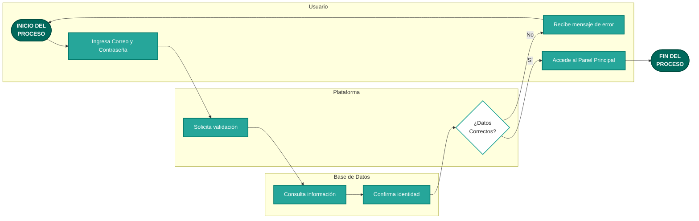
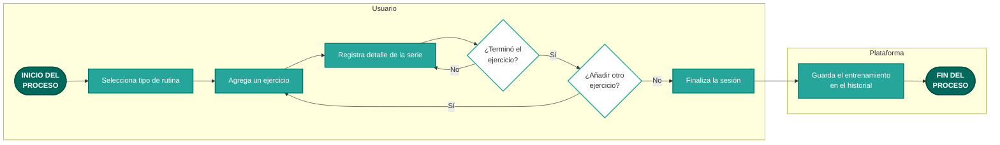
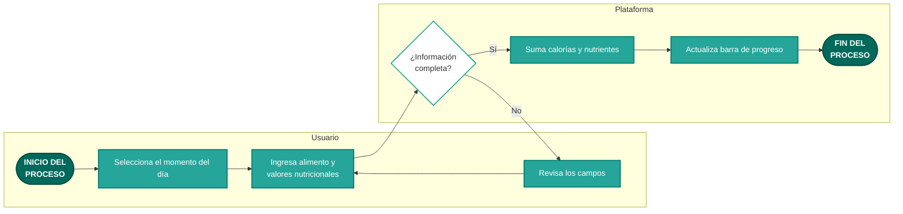

# Diagramas de Uso del Sistema - HyperTrack

A continuación se presentan los flujos principales de la plataforma HyperTrack, explicados de forma sencilla y orientada a la experiencia del usuario final.

## 1. Inicio de Sesión de Usuarios

Este diagrama muestra cómo un usuario accede a la plataforma de forma segura para ver su información personal.

## 2. Registro de una Sesión de Entrenamiento

Así es como un usuario guarda sus rutinas de ejercicio diario para llevar el control de su progreso.

## 3. Generación de Gráficas de Progreso (Sobrecarga Progresiva)

Este proceso explica cómo el sistema analiza automáticamente los entrenamientos pasados para mostrarle al usuario cuánto ha mejorado.

```mermaid
flowchart LR
    classDef startEnd fill:#00695c,stroke:#004d40,stroke-width:2px,color:#fff,font-weight:bold;
    classDef process fill:#26a69a,stroke:#00796b,stroke-width:2px,color:#fff;
    classDef condition fill:#fff,stroke:#26a69a,stroke-width:2px,color:#333;

    subgraph Plataforma
        A([INICIO DEL<br/>PROCESO]):::startEnd
        B[Recopila entrenamientos<br/>del último mes]:::process
        C[Extrae ejercicios y series]:::process
        D[Calcula volumen total]:::process
        E[Organiza información]:::process
        F[Genera Gráfica de Progreso]:::process
    end

    subgraph Usuario
        G[Visualiza gráfica en el panel]:::process
        H([FIN DEL<br/>PROCESO]):::startEnd
    end

    A --> B
    B --> C
    C --> D
    D --> E
    E --> F
    F --> G
    G --> H
```

## 4. Registro Diario de Comidas y Nutrición

Flujo de cómo un usuario registra lo que come para llevar el control de sus calorías y nutrientes (proteínas, carbohidratos, grasas).

