# Diagrama Entidad-Relación (ER) - HyperTrack

A continuación se presenta el modelo de datos completo de la plataforma HyperTrack, incluyendo tanto las colecciones principales documentadas en los esquemas de la aplicación como las colecciones de infraestructura (roles, auditoría, organizaciones) encontradas en la base de datos MongoDB.

## Diagrama ER Completo

```mermaid
erDiagram
    USERS ||--o| PROFILES : "tiene un"
    USERS ||--o{ WORKOUT_SESSIONS : "realiza"
    USERS ||--o{ NUTRITION_PLANS : "se le asigna"
    USERS ||--o{ MEAL_LOGS : "registra"
    USERS ||--o{ BODY_MEASUREMENTS : "registra"
    USERS ||--o{ PROGRESS_PHOTOS : "sube"
    USERS ||--o| DASHBOARD_CACHE : "posee"
    
    USERS }o--o{ ROLES : "posee (referencia)"
    ROLES ||--o{ PERMISSIONS : "incluye"

    ORGANIZATIONS ||--o{ ORGANIZATION_MEMBERS : "tiene"
    USERS ||--o{ ORGANIZATION_MEMBERS : "pertenece a"

    TRAINING_PROGRAMS ||--o{ PROGRAM_VERSIONS : "tiene"
    PROGRAM_VERSIONS ||--o{ PROGRAM_ASSIGNMENTS : "asignado en"
    USERS ||--o{ PROGRAM_ASSIGNMENTS : "recibe"

    EXERCISE_LIBRARY ||--o{ WORKOUT_SESSIONS : "referenciado en"

    USERS {
        ObjectId _id PK
        String publicId
        String email
        String password_hash
        String role "Opcional (Ej. COACH, NUTRITIONIST)"
        Date createdAt
        Date updatedAt
    }

    PROFILES {
        ObjectId _id PK
        ObjectId userId FK "Ref: USERS"
        String firstName
        String lastName
        Enum sex "MALE, FEMALE, OTHER..."
        Date birthDate
        String phone
        Number heightCm
        Number weightKg
        Enum primaryGoal
        Enum measurementSystem
    }

    ROLES {
        ObjectId _id PK
        String publicId
        String code "Ej: client, coach"
        String name
        String description
        String scope
        Array permissions FK "Ref: PERMISSIONS"
    }

    PERMISSIONS {
        ObjectId _id PK
        String publicId
        String code "Ej: workout.create"
        String name
        String module
        String action
    }

    EXERCISE_LIBRARY {
        ObjectId _id PK
        String publicId
        String name
        Enum primaryMuscle
        Array secondaryMuscles
        Enum mechanic
        Enum equipment
    }

    WORKOUT_SESSIONS {
        ObjectId _id PK
        ObjectId userId FK "Ref: USERS"
        ObjectId programId FK "Ref: TRAINING_PROGRAMS (Opcional)"
        Enum type "FREE, PROGRAM"
        String name
        Date startedAt
        Date finishedAt
        Array exercises "Ejercicios y Series (Embebidos)"
    }

    NUTRITION_PLANS {
        ObjectId _id PK
        ObjectId userId FK "Ref: USERS"
        Number dailyCalories
        Object macros "protein, carbs, fats"
    }

    MEAL_LOGS {
        ObjectId _id PK
        ObjectId userId FK "Ref: USERS"
        Enum mealType
        String foodName
        Number calories
        Object macros
        Date createdAt
    }

    BODY_MEASUREMENTS {
        ObjectId _id PK
        ObjectId userId FK "Ref: USERS"
        Number weight
        Number bodyFatPercentage
        Date recordedAt
    }
    
    PROGRESS_PHOTOS {
        ObjectId _id PK
        ObjectId userId FK "Ref: USERS"
        String photoUrl
        Date uploadedAt
    }

    ORGANIZATIONS {
        ObjectId _id PK
        String name
        String ownerId FK "Ref: USERS"
    }

    ORGANIZATION_MEMBERS {
        ObjectId _id PK
        ObjectId organizationId FK "Ref: ORGANIZATIONS"
        ObjectId userId FK "Ref: USERS"
        String role
    }

    TRAINING_PROGRAMS {
        ObjectId _id PK
        String name
        String description
        ObjectId authorId FK "Ref: USERS"
    }

    PROGRAM_VERSIONS {
        ObjectId _id PK
        ObjectId programId FK "Ref: TRAINING_PROGRAMS"
        String versionNumber
        Array weeks "Estructura del programa"
    }

    PROGRAM_ASSIGNMENTS {
        ObjectId _id PK
        ObjectId versionId FK "Ref: PROGRAM_VERSIONS"
        ObjectId clientId FK "Ref: USERS"
        Date startDate
    }

    DASHBOARD_CACHE {
        ObjectId _id PK
        ObjectId userId FK "Ref: USERS"
        Object statistics "Métricas cacheadas"
        Date lastComputed
    }

    AUDIT_LOGS {
        ObjectId _id PK
        String action
        ObjectId userId FK "Ref: USERS"
        Object details
        Date timestamp
    }
```

## Notas sobre la Arquitectura de Datos (NoSQL)

Dado que HyperTrack utiliza **MongoDB**, algunas relaciones no son estrictamente referenciales como en SQL, sino que aprovechan el modelo de documentos **embebidos**:

1. **Sesiones de Entrenamiento (`workout_sessions`)**: Para mantener un alto rendimiento de lectura/escritura y evitar *joins* (agregaciones pesadas), los ejercicios y sus respectivas series (sets) se guardan embebidos dentro del documento de la sesión principal, referenciando solo por ID al `EXERCISE_LIBRARY`.
2. **Macros Nutricionales**: Tanto en los planes de nutrición como en los registros diarios de comidas, los valores de macronutrientes (proteínas, carbohidratos, grasas) se almacenan como un sub-documento.
3. **Colecciones Administrativas**: Colecciones como `audit_logs`, `permissions` y `roles` conforman la infraestructura de seguridad y trazabilidad del sistema (RBAC).
4. **Programas y Organizaciones**: Permiten a los profesionales (entrenadores) agrupar clientes y asignarles rutinas con versiones específicas.
