# Diseño Lógico de la Base de Datos - HyperTrack

> Diagrama generado a partir de la inspección directa de la base de datos MongoDB local (`HyperTrackb`).  
> **19 colecciones** encontradas. Estructura de cada documento verificada contra datos reales.

---

## Diagrama Entidad-Relación (PlantUML)

```plantuml
@startuml HyperTrack_ER
!theme plain
skinparam linetype ortho
skinparam EntityBackgroundColor #1A1A1A
skinparam EntityBorderColor #DC2626
skinparam EntityFontColor #FFFFFF
skinparam EntityHeaderBackgroundColor #DC2626
skinparam EntityHeaderFontColor #FFFFFF
skinparam AttributeFontColor #D4D4D8
skinparam ArrowColor #71717A
skinparam BackgroundColor #09090B

title Diseño Lógico — Base de Datos HyperTrack (MongoDB)\n19 Colecciones · NoSQL Document Store

' ══════════════════════════════════════════════════
' ENTIDADES PRINCIPALES (con datos reales)
' ══════════════════════════════════════════════════

entity "users" as U {
  * _id : ObjectId <<PK>>
  --
  * publicId : String <<UK>>
  --
  * email.value : String
  * email.normalized : String
  * email.verified : Boolean
  email.verifiedAt : Date | null
  --
  * authentication.passwordHash : String
  * authentication.algorithm : String ("argon2id")
  authentication.failedAttempts : Number
  authentication.lockedUntil : Date | null
  --
  * account.status : Enum("PENDING_VERIFICATION","ACTIVE","SUSPENDED")
  account.language : String ("es-PE")
  account.timezone : String ("America/Lima")
  --
  * role : Enum("USER","COACH","NUTRITIONIST","ADMIN")
  --
  metadata.schemaVersion : Number
  metadata.source : String ("web")
  --
  * audit.createdAt : Date
  * audit.updatedAt : Date
  audit.lastLoginAt : Date | null
}

entity "profiles" as P {
  * _id : ObjectId <<PK>>
  * userId : ObjectId <<FK -> users>>
  * publicId : String <<UK>>
  --
  * identity.firstName : String
  * identity.lastName : String
  identity.displayName : String
  --
  contact.phone : String
  contact.country : String
  --
  demographics.birthDate : Date
  * demographics.sex : Enum("MALE","FEMALE")
  --
  * physical.heightCm : Number
  physical.weightKg : Number
  physical.bodyFatPercentage : Number
  physical.activityLevel : Enum
  physical.waistCircumference : Number
  physical.hipCircumference : Number
  physical.waistToHipRatio : Number
  --
  goals.primaryGoal : Enum("HYPERTROPHY","STRENGTH","FAT_LOSS","ENDURANCE")
  goals.stressLevel : Enum
  goals.sleepHoursAvg : Number
  --
  training.experience : Enum
  training.frequencyDays : Number
  --
  preferences.measurementSystem : Enum("METRIC","IMPERIAL")
  --
  medical.injuries : Array<String>
  medical.allergies : Array<String>
  --
  metadata.schemaVersion : Number
  * audit.createdAt : Date
  * audit.updatedAt : Date
}

entity "body_measurements" as BM {
  * _id : ObjectId <<PK>>
  * userId : ObjectId <<FK -> users>>
  --
  * date : Date
  * weight : Number
  bodyFatPercentage : Number
  waist : Number
  hip : Number
  chest : Number
  arm : Number
  thigh : Number
  calf : Number
  waistToHipRatio : Number
  notes : String
}

entity "exercise_library" as EL {
  * _id : ObjectId <<PK>>
  * publicId : String <<UK>>
  --
  * name : String
  * primaryMuscle : Enum("CHEST","BACK","SHOULDERS","LEGS","ARMS","CORE")
  * mechanic : Enum("COMPOUND","ISOLATION")
  * equipment : Enum("BARBELL","DUMBBELL","MACHINE","BODYWEIGHT","CABLE")
  * status : Enum("ACTIVE","INACTIVE")
  --
  * audit.createdAt : Date
  * audit.updatedAt : Date
}

entity "training_programs" as TP {
  * _id : ObjectId <<PK>>
  * publicId : String <<UK>>
  * authorId : ObjectId <<FK -> users (COACH)>>
  --
  * name : String
  description : String
  * goal : Enum("HYPERTROPHY","STRENGTH","ENDURANCE")
  * level : Enum("BEGINNER","INTERMEDIATE","ADVANCED")
  * status : Enum("ACTIVE","INACTIVE","ARCHIVED")
  --
  * exercises : Array<ExerciseDoc> <<Embedded>>
  .. exercises[].order : Number ..
  .. exercises[].exerciseId : String (ref exercise_library) ..
  .. exercises[].exerciseName : String ..
  .. exercises[].targetSets : Number ..
  .. exercises[].targetReps : Number ..
  .. exercises[].targetRpe : Number ..
  .. exercises[].restSeconds : Number ..
  --
  * audit.createdAt : Date
  * audit.updatedAt : Date
  audit.createdBy : ObjectId
}

entity "workout_programs" as WP {
  * _id : ObjectId <<PK>>
  --
  * name : String
  * authorId : String (ref users.publicId)
  * clientId : String (ref users.publicId)
  * status : Enum("ACTIVE","INACTIVE","ARCHIVED")
  * assignedDays : Array<Enum("MONDAY".."SUNDAY")>
  --
  * exercises : Array<ExerciseDoc> <<Embedded>>
  .. exercises[].exerciseName : String ..
  .. exercises[].sets[] : Array<SetDoc> ..
  .. exercises[].sets[].setNumber : Number ..
  .. exercises[].sets[].reps : Number ..
  .. exercises[].sets[].weight : Number ..
  .. exercises[].sets[].unit : Enum("KG","LBS") ..
  --
  * createdAt : Date
  * updatedAt : Date
}

entity "program_assignments" as PA {
  * _id : ObjectId <<PK>>
  * publicId : String <<UK>>
  --
  * clientId : ObjectId <<FK -> users>>
  * coachId : ObjectId <<FK -> users>>
  * programVersionId : ObjectId <<FK -> training_programs>>
  --
  * status : Enum("ACTIVE","COMPLETED","CANCELLED")
  * startDate : Date
  endDate : Date
  --
  * audit.createdAt : Date
  * audit.updatedAt : Date
  audit.createdBy : ObjectId
}

entity "program_versions" as PV {
  * _id : ObjectId <<PK>>
  --
  (Colección vacía — reservada
  para versionado futuro
  de programas de entrenamiento)
}

entity "workout_sessions" as WS {
  * _id : ObjectId <<PK>>
  * publicId : String <<UK>>
  * clientId : ObjectId <<FK -> users>>
  --
  * status : Enum("COMPLETED","IN_PROGRESS","CANCELLED")
  * type : Enum("FREE","PROGRAM")
  * name : String
  * startedAt : Date
  finishedAt : Date
  durationMinutes : Number
  --
  * exercises : Array<SessionExerciseDoc> <<Embedded>>
  .. exercises[].exerciseId : ObjectId ..
  .. exercises[].order : Number ..
  .. exercises[].exerciseName : String ..
  .. exercises[].sets[] : Array<SetDoc> ..
  .. exercises[].sets[].setNumber : Number ..
  .. exercises[].sets[].setType : Enum("WORKING","WARMUP") ..
  .. exercises[].sets[].reps : Number ..
  .. exercises[].sets[].weight : Number ..
  .. exercises[].sets[].unit : Enum("KG","LBS") ..
  .. exercises[].sets[].rpe : Number ..
  .. exercises[].sets[].completed : Boolean ..
  --
  metadata.schemaVersion : Number
  metadata.source : String
  * audit.createdAt : Date
  * audit.updatedAt : Date
}

entity "personal_records" as PR {
  * _id : ObjectId <<PK>>
  * clientId : ObjectId <<FK -> users>>
  * workoutSessionId : ObjectId <<FK -> workout_sessions>>
  --
  * exerciseId : String
  * exerciseName : String
  * maxWeight : String
  * maxWeightReps : String
  * maxWeightUnit : Enum("KG","LBS")
  estimated1RM : Number
  * dateAchieved : Date
  --
  * audit.createdAt : Date
  * audit.updatedAt : Date
}

entity "nutrition_plans" as NP {
  * _id : ObjectId <<PK>>
  * publicId : String <<UK>>
  * clientId : ObjectId <<FK -> users>>
  --
  * status : Enum("ACTIVE","ARCHIVED")
  --
  * dailyTargets.calories : Number
  * dailyTargets.proteinGrams : Number
  * dailyTargets.carbsGrams : Number
  * dailyTargets.fatsGrams : Number
  --
  * startDate : Date
  --
  * audit.createdAt : Date
  * audit.updatedAt : Date
  audit.createdBy : ObjectId <<FK -> users (NUTRITIONIST)>>
}

entity "meal_logs" as ML {
  * _id : ObjectId <<PK>>
  * userId : ObjectId <<FK -> users>>
  --
  * loggedAt : Date
  * mealType : Enum("BREAKFAST","LUNCH","DINNER","SNACK")
  --
  * nutrition.calories : Number
  * nutrition.protein : Number
  * nutrition.carbs : Number
  * nutrition.fats : Number
  nutrition.fiber : Number
  nutrition.hydrationLiters : Number
}

entity "dashboard_cache" as DC {
  * _id : ObjectId <<PK>>
  * clientId : ObjectId <<FK -> users>>
  --
  * period : Enum("WEEKLY","MONTHLY")
  * calculatedAt : Date
  * startDate : Date
  * endDate : Date
  --
  trainingMetrics.workoutsCompleted : Number
  trainingMetrics.totalVolumeKg : Number
  trainingMetrics.adherencePercentage : Number
  --
  nutritionMetrics.averageCalories : Number
  nutritionMetrics.adherencePercentage : Number
}

entity "audit_logs" as AL {
  * _id : ObjectId <<PK>>
  --
  * timestamp : Date
  * actorId : String (ref users.publicId)
  * action : Enum("ASSIGN_PROGRAM","CREATE_PLAN",...)
  targetId : ObjectId
  --
  details : Object (variable)
  .. details.programId : ObjectId ..
  .. details.programName : String ..
}

entity "roles" as R {
  * _id : ObjectId <<PK>>
  * publicId : String <<UK>>
  --
  * code : String ("client","coach")
  * name : String
  description : String
  * scope : Enum("personal","team")
  * priority : Number
  * isSystem : Boolean
  * status : Enum("active","inactive")
  --
  * permissions : Array<ObjectId> <<FK -> permissions>>
  features : Array<String>
  --
  * audit.createdAt : Date
  * audit.updatedAt : Date
}

entity "permissions" as PE {
  * _id : ObjectId <<PK>>
  * publicId : String <<UK>>
  --
  * code : String ("workout.create")
  * name : String
  description : String
  * module : String ("training")
  * resource : String ("workout")
  * action : String ("create")
  * category : String ("execution")
  * isSystem : Boolean
  * status : Enum("active","inactive")
  --
  * audit.createdAt : Date
  * audit.updatedAt : Date
}

entity "organizations" as ORG {
  * _id : ObjectId <<PK>>
  --
  (Colección vacía — reservada
  para gimnasios/centros
  deportivos)
}

entity "organization_members" as OM {
  * _id : ObjectId <<PK>>
  --
  (Colección vacía — reservada
  para membresías de
  usuarios en organizaciones)
}

entity "progress_photos" as PP {
  * _id : ObjectId <<PK>>
  --
  (Colección vacía — reservada
  para fotos de progreso
  físico del atleta)
}


' ══════════════════════════════════════════════════
' RELACIONES Y CARDINALIDADES
' ══════════════════════════════════════════════════

' --- Usuario como centro ---
U ||--|| P : "1:1 Tiene perfil"
U ||--o{ BM : "1:N Registra medidas"
U ||--o{ WS : "1:N Realiza sesiones"
U ||--o{ ML : "1:N Registra comidas"
U ||--o{ PR : "1:N Obtiene récords"
U ||--o{ DC : "1:N Cachea métricas"

' --- Entrenador crea programas ---
U ||--o{ TP : "1:N Crea (como Coach)"
U ||--o{ WP : "1:N Crea rutinas"

' --- Asignaciones ---
U ||--o{ PA : "1:N Recibe asignaciones"
TP ||--o{ PA : "1:N Se asigna via"

' --- Nutricionista asigna planes ---
U ||--o{ NP : "1:N Recibe plan nutricional"

' --- Sesión registra PRs ---
WS ||--o{ PR : "1:N Genera récords"

' --- Roles y Permisos (RBAC) ---
R ||--o{ PE : "N:M Incluye permisos"

' --- Organizaciones (futuro) ---
ORG ||--o{ OM : "1:N Tiene miembros"
U ||--o{ OM : "1:N Pertenece a"

' --- Catálogo ---
EL ..> TP : "Referenciado por\nexercises[].exerciseId"
EL ..> WS : "Referenciado por\nexercises[].exerciseId"

@enduml
```

---

## Inventario Completo de Colecciones (19)

| # | Colección | Documentos | Propósito |
|---|-----------|:----------:|-----------|
| 1 | `users` | 8 | Usuarios del sistema (atletas, coaches, nutricionistas, admin) |
| 2 | `profiles` | 4 | Perfil detallado del usuario (identidad, físico, metas, médico) |
| 3 | `body_measurements` | 0 | Historial de mediciones corporales (peso, circunferencias) |
| 4 | `exercise_library` | 25 | Catálogo maestro de ejercicios (nombre, músculo, equipo) |
| 5 | `training_programs` | 2 | Plantillas de programa creadas por coaches (con ejercicios embebidos) |
| 6 | `workout_programs` | 8 | Rutinas personalizadas con sets/reps predefinidos |
| 7 | `program_assignments` | 7 | Vínculo Coach → Atleta (asigna un programa a un cliente) |
| 8 | `program_versions` | 0 | Reservada para versionado de programas (sin datos aún) |
| 9 | `workout_sessions` | 6 | Sesiones reales de entrenamiento (lo que hizo el atleta en el gym) |
| 10 | `personal_records` | 1 | Récords personales (PR) por ejercicio |
| 11 | `nutrition_plans` | 1 | Planes nutricionales asignados por el nutricionista |
| 12 | `meal_logs` | 0 | Registro diario de comidas y macros |
| 13 | `dashboard_cache` | 10 | Caché de métricas pre-calculadas para el dashboard |
| 14 | `audit_logs` | 1 | Bitácora de auditoría de acciones sensibles |
| 15 | `roles` | 2 | Definición de roles del sistema (RBAC) |
| 16 | `permissions` | 2 | Permisos granulares por módulo/recurso/acción |
| 17 | `organizations` | 0 | Reservada para gimnasios/centros deportivos |
| 18 | `organization_members` | 0 | Reservada para membresías en organizaciones |
| 19 | `progress_photos` | 0 | Reservada para fotos de progreso físico |

---

## Resumen de Cardinalidades

| Relación | Tipo | Descripción |
|----------|:----:|-------------|
| `users` → `profiles` | **1:1** | Cada usuario tiene exactamente un perfil |
| `users` → `body_measurements` | **1:N** | Un usuario registra múltiples mediciones en el tiempo |
| `users` → `workout_sessions` | **1:N** | Un usuario realiza múltiples sesiones de entrenamiento |
| `users` → `meal_logs` | **1:N** | Un usuario registra múltiples comidas |
| `users` → `personal_records` | **1:N** | Un usuario puede tener múltiples PRs |
| `users` (Coach) → `training_programs` | **1:N** | Un coach crea múltiples programas |
| `users` (Coach) → `program_assignments` | **1:N** | Un coach hace múltiples asignaciones |
| `users` (Atleta) → `program_assignments` | **1:N** | Un atleta recibe múltiples asignaciones |
| `training_programs` → `program_assignments` | **1:N** | Un programa se asigna a múltiples atletas |
| `users` (Nutricionista) → `nutrition_plans` | **1:N** | Un nutricionista crea múltiples planes |
| `users` (Atleta) → `nutrition_plans` | **1:N** | Un atleta puede tener múltiples planes (solo 1 activo) |
| `workout_sessions` → `personal_records` | **1:N** | Una sesión puede generar múltiples PRs |
| `roles` → `permissions` | **N:M** | Un rol incluye múltiples permisos |
| `organizations` → `organization_members` | **1:N** | Una organización tiene múltiples miembros |
| `users` → `dashboard_cache` | **1:N** | Un usuario tiene múltiples entradas de caché (semanal/mensual) |

*(Nota: Los sub-documentos embebidos como `exercises[]` dentro de `training_programs` y `workout_sessions` no generan colecciones separadas — están anidados dentro del documento padre para optimizar la lectura en MongoDB.)*
