# Diseño Físico de la Base de Datos - HyperTrack

El siguiente diagrama en **PlantUML** representa el esquema físico de las **19 colecciones** de la base de datos MongoDB local (`HyperTrackb`). En él se detallan los tipos de datos BSON, validaciones de esquema nativas (`$jsonSchema`), e índices (optimizaciones y llaves únicas).

```plantuml
@startuml HyperTrack_Physical_Design_Complete
!theme plain
skinparam classBackgroundColor #1A1A1A
skinparam classBorderColor #DC2626
skinparam classFontColor #FFFFFF
skinparam classHeaderBackgroundColor #DC2626
skinparam classAttributeFontColor #D4D4D8
skinparam noteBackgroundColor #27272A
skinparam noteBorderColor #52525B
skinparam noteFontColor #E4E4E7
skinparam BackgroundColor #09090B
left to right direction

title Diseño Físico Completo — 19 Colecciones MongoDB (HyperTrackb)

' ==========================================
' 1. USERS & PERFILES
' ==========================================
class "users" <<Collection>> {
  + _id : ObjectId
  ~ publicId : String [^usr_[A-Z0-9]{26}$]
  ~ email.value : String
  ~ authentication.passwordHash : String <<Argon2id>>
  ~ role : String [Enum]
  ~ account.status : String
}
note right of users
  **Índices:**
  - _id_
  - idx_unique_user_public_id <<UNIQUE>>
  - idx_unique_email <<UNIQUE>>
  - idx_user_status_role
  **Validación ($jsonSchema):**
  required: ["publicId", "email", "authentication", "account", "role", "metadata", "audit"]
end note

class "profiles" <<Collection>> {
  + _id : ObjectId
  ~ userId : ObjectId
  ~ publicId : String
  ~ identity : Object
  ~ physical : Object
  ~ goals : Object
}
note right of profiles
  **Índices:**
  - _id_
  - idx_unique_user_id <<UNIQUE>>
  - idx_unique_profile_public_id <<UNIQUE>>
  - idx_unique_phone <<UNIQUE>>
  - idx_name_composite
  **Validación ($jsonSchema):**
  required: ["userId", "publicId", "identity", "contact", "demographics", "physical", "goals"...]
end note

class "body_measurements" <<Collection>> {
  + _id : ObjectId
  ~ userId : ObjectId
  ~ date : Date
  ~ weight : Double
}
note right of body_measurements
  **Índices:**
  - _id_
  - idx_client_measurements
end note

class "progress_photos" <<Collection>> {
  + _id : ObjectId
  ~ clientId : ObjectId
  ~ logDate : Date
  ~ photos : Array<Object>
}
note right of progress_photos
  **Índices:**
  - _id_
  - idx_client_photos_history {logDate: -1}
  **Validación ($jsonSchema):**
  required: ["publicId", "clientId", "logDate", "photos", "audit"]
end note

' ==========================================
' 2. ENTRENAMIENTO & EJERCICIOS
' ==========================================
class "exercise_library" <<Collection>> {
  + _id : ObjectId
  ~ publicId : String
  ~ name : String
  ~ primaryMuscle : String
}
note right of exercise_library
  **Índices:**
  - _id_
  - idx_unique_exe_public_id <<UNIQUE>>
  - idx_muscle_mechanic
  **Validación ($jsonSchema):**
  required: ["publicId", "name", "primaryMuscle", "mechanic", "equipment", "status", "audit"]
end note

class "training_programs" <<Collection>> {
  + _id : ObjectId
  ~ publicId : String
  ~ authorId : ObjectId
  ~ exercises : Array<Object>
}
note right of training_programs
  **Índices:**
  - _id_
  - idx_unique_prg_public_id <<UNIQUE>>
  - idx_author_status
  **Validación ($jsonSchema):**
  required: ["publicId", "authorId", "name", "goal", "level", "status", "audit"]
end note

class "workout_programs" <<Collection>> {
  + _id : ObjectId
  ~ name : String
  ~ exercises : Array<Object>
}
note right of workout_programs
  **Índices:**
  - _id_
end note

class "program_versions" <<Collection>> {
  + _id : ObjectId
}
note right of program_versions
  **Índices:**
  - _id_
end note

class "program_assignments" <<Collection>> {
  + _id : ObjectId
  ~ clientId : ObjectId
  ~ programVersionId : ObjectId
  ~ status : String
}
note right of program_assignments
  **Índices:**
  - _id_
  - idx_client_assignment_status
  **Validación ($jsonSchema):**
  required: ["publicId", "clientId", "programVersionId", "status", "startDate", "audit"]
end note

class "workout_sessions" <<Collection>> {
  + _id : ObjectId
  ~ clientId : ObjectId
  ~ startedAt : Date
  ~ exercises : Array<Object>
}
note right of workout_sessions
  **Índices:**
  - _id_
  - idx_client_history {startedAt: -1}
  - idx_assignment
  - idx_status
  **Validación ($jsonSchema):**
  required: ["publicId", "clientId", "status", "startedAt", "exercises", "audit"]
end note

class "personal_records" <<Collection>> {
  + _id : ObjectId
  ~ clientId : ObjectId
  ~ exerciseName : String
  ~ maxWeight : String
}
note right of personal_records
  **Índices:**
  - _id_
end note

' ==========================================
' 3. NUTRICIÓN
' ==========================================
class "nutrition_plans" <<Collection>> {
  + _id : ObjectId
  ~ clientId : ObjectId
  ~ dailyTargets : Object
}
note right of nutrition_plans
  **Índices:**
  - _id_
  - idx_client_nutrition_status
  **Validación ($jsonSchema):**
  required: ["publicId", "clientId", "status", "dailyTargets", "startDate", "audit"]
end note

class "meal_logs" <<Collection>> {
  + _id : ObjectId
  ~ clientId : ObjectId
  ~ logDate : Date
  ~ totals : Object
}
note right of meal_logs
  **Índices:**
  - _id_
  - idx_unique_client_daily_log <<UNIQUE>>
  **Validación ($jsonSchema):**
  required: ["publicId", "clientId", "logDate", "totals", "meals", "audit"]
end note

' ==========================================
' 4. ORGANIZACIONES
' ==========================================
class "organizations" <<Collection>> {
  + _id : ObjectId
  ~ publicId : String
  ~ name : String
}
note right of organizations
  **Índices:**
  - _id_
  - idx_unique_org_public_id <<UNIQUE>>
  - idx_org_status
  **Validación ($jsonSchema):**
  required: ["publicId", "name", "contact", "billing", "settings", "status", "metadata", "audit"]
end note

class "organization_members" <<Collection>> {
  + _id : ObjectId
  ~ organizationId : ObjectId
  ~ userId : ObjectId
}
note right of organization_members
  **Índices:**
  - _id_
  - idx_unique_org_user <<UNIQUE>>
  - idx_user_memberships
  **Validación ($jsonSchema):**
  required: ["organizationId", "userId", "roles", "status", "joinedAt", "audit"]
end note

' ==========================================
' 5. SISTEMA, RBAC & CACHE
' ==========================================
class "roles" <<Collection>> {
  + _id : ObjectId
  ~ code : String
  ~ permissions : Array<ObjectId>
}
note right of roles
  **Índices:**
  - _id_
  - idx_unique_role_public_id <<UNIQUE>>
  - idx_unique_role_code <<UNIQUE>>
  - idx_role_status
  **Validación ($jsonSchema):**
  required: ["publicId", "code", "name", "scope", "priority", "status", "audit"]
end note

class "permissions" <<Collection>> {
  + _id : ObjectId
  ~ code : String
  ~ resource : String
}
note right of permissions
  **Índices:**
  - _id_
  - idx_unique_perm_public_id <<UNIQUE>>
  - idx_unique_perm_code <<UNIQUE>>
  - idx_perm_module
  **Validación ($jsonSchema):**
  required: ["publicId", "code", "name", "module", "resource", "action", "status", "audit"]
end note

class "audit_logs" <<Collection>> {
  + _id : ObjectId
  ~ actorId : String
  ~ action : String
  ~ timestamp : Date
}
note right of audit_logs
  **Índices:**
  - _id_
  - idx_actor_history {timestamp: -1}
  **Validación ($jsonSchema):**
  required: ["timestamp", "actorId", "action"]
end note

class "dashboard_cache" <<Collection>> {
  + _id : ObjectId
  ~ clientId : ObjectId
  ~ period : String
}
note right of dashboard_cache
  **Índices:**
  - _id_
  - idx_client_cache <<UNIQUE>>
  **Validación ($jsonSchema):**
  required: ["clientId", "period", "calculatedAt", "startDate", "endDate"]
end note

@enduml
```

